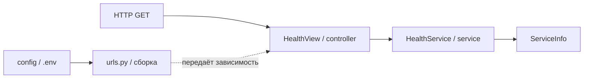

# CommandX · Архитектура каркаса ЛР3

Сохранены решения [архитектуры №1](https://github.com/bendyou/RSP/blob/lab1/ARCHITECTURE.md). Контракт №2 перенесён в корневой [openapi.yaml](openapi.yaml). Оба документа включены в состав каркаса по структуре из [методички ЛР3](https://drive.google.com/file/d/1ItS06gGjfcJxSDQE92Z3sed-lO74Onh0/view).

## Предметная область из №1

CommandX — веб-панель для собственных Linux-серверов: SSH-команды, файлы, Python-пакеты, мониторинг и история измерений; профиль, подписка и опциональный AI. Исходный проект использует React/TypeScript/Vite, Django REST Framework, Paramiko, SimpleJWT и SQLite/PostgreSQL.

Гость регистрируется и входит, пользователь управляет своими серверами, администратор (`is_staff`) дополнительно управляет пользователями и подписками. Фильтр серверов по created_by действует и для администратора. Server.is_active означает доступ в панели, а не питание ОС.

| Сущность | Назначение |
| --- | --- |
| User | Учётная запись, роль и активность |
| UserProfile | Профиль, баланс, текущая подписка |
| Server | SSH-реквизиты и владелец |
| ServerMetric | Измерения и время получения |
| Transaction | События баланса и подписки |
| AllocatedServer | Legacy-модель, без активного публичного API |

[Полный словарь и 3НФ](https://github.com/bendyou/RSP/blob/lab1/ARCHITECTURE.md), [C4 Container](https://github.com/bendyou/RSP/blob/lab1/diagrams/c4-containers.svg) и [ERD](https://github.com/bendyou/RSP/blob/lab1/diagrams/erd.svg) остаются в №1. В №3 модели и миграции не создаются.

## Layered Architecture

| Слой | Файлы | Ответственность |
| --- | --- | --- |
| Точка входа | main.py, manage.py, app/wsgi.py, app/asgi.py | Запуск Django и адрес сервера |
| Config | app/config | Загрузка и проверка .env/окружения, настройки framework |
| Controller | app/controller/health.py | HTTP, вызов сервиса, сериализация JSON |
| Service | app/service/health.py | Состояние процесса и uptime, только стандартная библиотека |
| Repository | app/repository | Место для будущего ORM-адаптера; в health не используется |
| Composition root | app/urls.py | Создание сервиса, ServiceInfo и привязка к контроллеру |

Контроллер не вычисляет uptime и не выполняет SQL. Сервис не импортирует Django, DRF, конфигурацию .env или контроллеры, не получает request и не хранит секреты. Он принимает обычный ServiceInfo. Реализация репозитория потребуется при появлении сценария с данными; фиктивные CRUD-заглушки не создаются.

## Health и совместимость

Основной маршрут сдачи — **GET /api/v1/health**, как в разделе отчётности методички. GET /health — допустимый короткий вариант. Прежний GET /api/health/ сохранён для совместимости с №2. Все URL используют один сервис и одну форму JSON-ответа, без JWT и перенаправлений.

Функциональные маршруты CommandX сохраняют /api/ и завершающий слеш. /api/v1/health — точечное дополнение по заданию, а не перенос всего API на новую версию.

Ответ: status=pass, app_name, version, environment, uptime_seconds. Монотонные часы обеспечивают отсчёт длительности независимо от смены календарного времени. Health не выдаёт секрет, адрес БД, SSH-реквизиты или локальные пути; не проверяет внешние сервисы.

## Окружение и тесты

.env.example содержит имена переменных и пустой слот секрета. tools/init_env.py генерирует собственное значение в локальном .env, сохраняя существующие параметры. .env исключён из Git. Окружение процесса приоритетнее файла; загрузка не меняет os.environ.

У секрета нет литерала по умолчанию. Неверные обязательные значения, порт или production/debug-сочетание останавливают запуск. Тесты используют отдельный случайный секрет, SQLite в памяти и не читают рабочий .env.

OpenAPI содержит 24 операции: 3 реализованных health и 21 операцию будущих этапов, отмеченную x-lab3-implemented=false. [Сверка задания](docs/ASSIGNMENT.md) · [Проверки](docs/REVIEW.md) · [Контекст источника](docs/PROJECT_CONTEXT.md).
