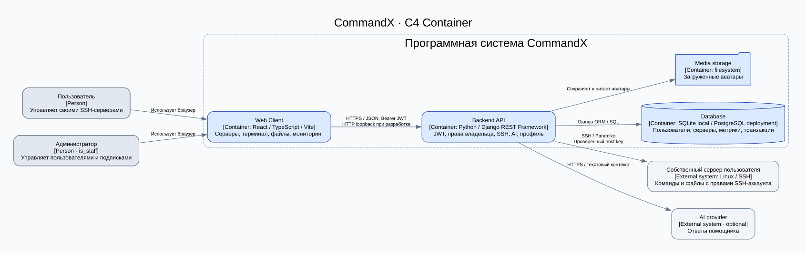
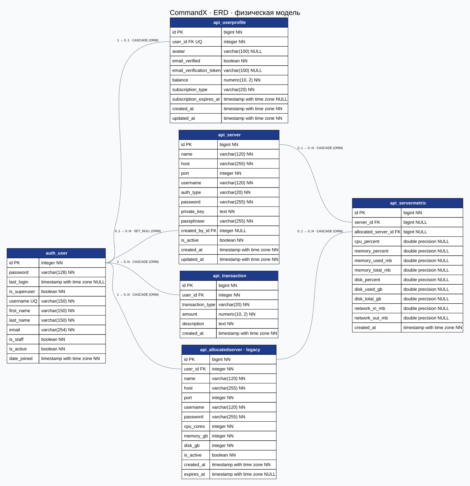

# CommandX — архитектура серверного приложения

Лабораторная работа №1 по дисциплине «Разработка серверных приложений». Тема сквозного проекта: **панель управления собственными серверами по SSH**. Модель сверена с рабочим деревом `pic_project` 26.11.2026; [контекст и границы](docs/PROJECT_CONTEXT.md).

## 1. Назначение и границы

CommandX предоставляет веб-интерфейс для подключения к Linux-серверам пользователя: выполнение команд, просмотр и редактирование файлов, управление Python-пакетами, сбор метрик CPU/RAM/диска и история измерений. Есть профиль, баланс, подписки, административное управление пользователями и опциональный AI-помощник.

Это монолит Django REST Framework с React-клиентом. В архитектуре нет собственного агента мониторинга, очереди, таблиц инцидентов или механизма предиктивного анализа. Реального платёжного провайдера нет. Выданные `AllocatedServer` относятся к legacy-модели и не имеют активного публичного API.

## 2. Роли и правила доступа

| Роль | Возможности | Граница |
| --- | --- | --- |
| Гость | Регистрация, получение и обновление токенов | Нет доступа к серверам и профилям |
| Пользователь | Собственный профиль, свои SSH-серверы, команды, файлы, метрики, подписка и история транзакций | Объекты серверов фильтруются по `created_by` |
| Администратор | Всё для собственных серверов; дополнительно управление пользователями, балансами и подписками | Определяется `is_staff`; административная роль не отменяет фильтр владельца серверов |

Гость — не отдельная строка справочника ролей. Аутентификация — SimpleJWT: `access` и `refresh`; существующий проект использует срок access 1 час, refresh 7 дней. Заблокированный пользователь (`is_active=false`) не должен получать доступ по JWT. Переключатель `Server.is_active` приостанавливает удалённые действия в панели и не выключает ОС.

## 3. Основные Use Cases

| № | Роль и сценарий | Основные шаги | Результат / ошибка |
| --- | --- | --- | --- |
| UC-01 | Гость регистрируется | Ввести username, email, пароль и подтверждение; проверить поля и существование пользователя | Созданы User и профиль, выданы access/refresh; ошибки — 400 |
| UC-02 | Пользователь входит | Передать username/password, затем Bearer access | Токены либо 401; refresh обновляется отдельным запросом |
| UC-03 | Пользователь добавляет сервер | Указать name, host, port, SSH username и пароль либо приватный ключ | `created_by` задаёт сервер API; секреты не возвращаются |
| UC-04 | Пользователь редактирует/удаляет свой сервер | Проверить владельца, обновить запись или удалить её | Чужой сервер — 404; старое SSH-соединение закрывается |
| UC-05 | Пользователь проверяет подключение и выполняет команду | Проверить доступ, доверенный ключ хоста, SSH-реквизиты; выполнить команду | stdout/stderr/exit_code; при сетевом сбое автоматического повтора нет |
| UC-06 | Пользователь работает с файлами и пакетами | Открыть рабочую область своего сервера, передать путь или команду пакета | Операция через SSH с правами SSH-аккаунта; это не песочница |
| UC-07 | Пользователь просматривает мониторинг | Опросить SSH, сохранить сэмпл, запросить историю | Недавний сэмпл переиспользуется до 5 секунд; история до 168 часов и 2000 точек |
| UC-08 | Пользователь приостанавливает доступ | Переключить is_active в панели | Удалённые действия блокируются; карточка и история остаются доступны |
| UC-09 | Пользователь покупает подписку | Проверить тариф и баланс, списать сумму транзакционно, записать Transaction | Изменён профиль; нехватка средств — 400. Пополнение — только опциональное demo |
| UC-10 | Администратор управляет пользователями | Проверить JWT и is_staff; прочитать пользователей или изменить статус/баланс/подписку | Без роли — 403; серверы других владельцев по-прежнему недоступны |
| UC-11 | Пользователь задаёт вопрос AI | Проверить сообщения, вызвать опциональный внешний сервис | Ответ либо 503 без настроенного ключа; автоматического выполнения команд нет |

## 4. C4 Container, уровень 2



[Исходник Graphviz](diagrams/c4-containers.dot). Граница охватывает контейнеры CommandX; люди и внешние системы находятся снаружи. Контейнер C4 означает приложение/хранилище, а не обязательно Docker.

| Контейнер | Технологии | Ответственность |
| --- | --- | --- |
| Web Client | React, TypeScript, Vite | UI, формы, JWT-клиент, рабочая область и графики |
| Backend API | Python, Django 5.2, DRF, SimpleJWT, Paramiko | HTTP, права, сценарии, ORM, SSH и интеграции |
| Database | SQLite локально; PostgreSQL при развёртывании | Пользователи, серверы, метрики, профиль и транзакции |
| Media storage | Файловая система backend | Аватары; не содержимое удалённых SSH-серверов |

Клиент общается с API через HTTPS/JSON, в локальной разработке — HTTP loopback и Vite proxy. Backend использует ORM для SQL и Paramiko для SSH. Redis и очередь не нужны для текущего синхронного среза. AI-провайдер опционален. Пароли SSH и ключи не передаются внешнему AI автоматически.

## 5. Предметная область и ERD

Шесть основных сущностей: стандартный User и пять моделей приложения. Служебные таблицы Django auth (группы, permissions и связи N:M) не показаны на основной ERD; они включены в SQL для целостности схемы. Таблицы sessions, admin log, migrations и пользовательские данные в учебный экспорт не входят.



[Исходник ERD](diagrams/erd.dot), [PostgreSQL DDL](database/schema.sql). PK — первичный ключ, FK — внешний ключ, UQ — уникальность, NN — NOT NULL. Собственные PK приложения — BIGINT; стандартный `auth_user.id` — INTEGER по миграциям Django. Это явно отмеченное отличие от рекомендуемого в задании BIGINT/UUID: замена типа встроенного User ради отчёта нарушила бы соответствие исходному проекту.

### Словарь данных

#### 5.1. `auth_user` — User

| Поле | PostgreSQL | NULL | Ключи и правила |
| --- | --- | --- | --- |
| `id` | integer | нет | PK, identity |
| `password` | varchar(128) | нет | Не публиковать; User.password — хеш |
| `last_login` | timestamp with time zone | да | last login |
| `is_superuser` | boolean | нет | ORM default: `False` |
| `username` | varchar(150) | нет | UNIQUE |
| `first_name` | varchar(150) | нет | first name |
| `last_name` | varchar(150) | нет | last name |
| `email` | varchar(254) | нет | email address |
| `is_staff` | boolean | нет | ORM default: `False` |
| `is_active` | boolean | нет | ORM default: `True` |
| `date_joined` | timestamp with time zone | нет | ORM default: `<function now at 0x10a6ec9e0>` |

#### 5.2. `api_userprofile` — UserProfile

| Поле | PostgreSQL | NULL | Ключи и правила |
| --- | --- | --- | --- |
| `id` | bigint | нет | PK, identity |
| `user_id` | integer | нет | UNIQUE; FK → `auth_user.id`; ORM CASCADE |
| `avatar` | varchar(100) | да | Аватар |
| `email_verified` | boolean | нет | ORM default: `False` |
| `email_verification_token` | varchar(100) | да | Чувствительные данные; не выдавать в JSON |
| `balance` | numeric(10, 2) | нет | ORM default: `0.0` |
| `subscription_type` | varchar(20) | нет | ORM default: `none`; choices: `none`, `pro`, `plus` |
| `subscription_expires_at` | timestamp with time zone | да | Подписка истекает |
| `created_at` | timestamp with time zone | нет | Время создания задаёт ORM |
| `updated_at` | timestamp with time zone | нет | Время изменения задаёт ORM |

#### 5.3. `api_server` — Server

| Поле | PostgreSQL | NULL | Ключи и правила |
| --- | --- | --- | --- |
| `id` | bigint | нет | PK, identity |
| `name` | varchar(120) | нет | Название |
| `host` | varchar(255) | нет | Хост |
| `port` | integer | нет | ORM default: `22`; SQL CHECK ≥ 0 |
| `username` | varchar(120) | нет | Имя пользователя |
| `auth_type` | varchar(20) | нет | ORM default: `password`; choices: `password`, `private_key` |
| `password` | varchar(255) | нет | ORM default: ``; Чувствительные данные; не выдавать в JSON |
| `private_key` | text | нет | ORM default: ``; Чувствительные данные; не выдавать в JSON |
| `passphrase` | varchar(255) | нет | ORM default: ``; Чувствительные данные; не выдавать в JSON |
| `created_by_id` | integer | да | FK → `auth_user.id`; ORM SET_NULL |
| `is_active` | boolean | нет | ORM default: `True` |
| `created_at` | timestamp with time zone | нет | Время создания задаёт ORM |
| `updated_at` | timestamp with time zone | нет | Время изменения задаёт ORM |

#### 5.4. `api_transaction` — Transaction

| Поле | PostgreSQL | NULL | Ключи и правила |
| --- | --- | --- | --- |
| `id` | bigint | нет | PK, identity |
| `user_id` | integer | нет | FK → `auth_user.id`; ORM CASCADE |
| `transaction_type` | varchar(20) | нет | choices: `deposit`, `subscription_pro`, `subscription_plus`, `admin_grant` |
| `amount` | numeric(10, 2) | нет | Сумма |
| `description` | text | нет | Описание |
| `created_at` | timestamp with time zone | нет | Время создания задаёт ORM |

#### 5.5. `api_allocatedserver` — AllocatedServer

| Поле | PostgreSQL | NULL | Ключи и правила |
| --- | --- | --- | --- |
| `id` | bigint | нет | PK, identity |
| `user_id` | integer | нет | FK → `auth_user.id`; ORM CASCADE |
| `name` | varchar(120) | нет | Название |
| `host` | varchar(255) | нет | Хост |
| `port` | integer | нет | ORM default: `22`; SQL CHECK ≥ 0 |
| `username` | varchar(120) | нет | Имя пользователя |
| `password` | varchar(255) | нет | ORM default: ``; Чувствительные данные; не выдавать в JSON |
| `cpu_cores` | integer | нет | ORM default: `1`; SQL CHECK ≥ 0 |
| `memory_gb` | integer | нет | ORM default: `1`; SQL CHECK ≥ 0 |
| `disk_gb` | integer | нет | ORM default: `10`; SQL CHECK ≥ 0 |
| `is_active` | boolean | нет | ORM default: `True` |
| `created_at` | timestamp with time zone | нет | Время создания задаёт ORM |
| `expires_at` | timestamp with time zone | да | Истекает |

#### 5.6. `api_servermetric` — ServerMetric

| Поле | PostgreSQL | NULL | Ключи и правила |
| --- | --- | --- | --- |
| `id` | bigint | нет | PK, identity |
| `server_id` | bigint | да | FK → `api_server.id`; ORM CASCADE |
| `allocated_server_id` | bigint | да | FK → `api_allocatedserver.id`; ORM CASCADE |
| `cpu_percent` | double precision | да | CPU % |
| `memory_percent` | double precision | да | Память % |
| `memory_used_mb` | double precision | да | Память использовано (MB) |
| `memory_total_mb` | double precision | да | Память всего (MB) |
| `disk_percent` | double precision | да | Диск % |
| `disk_used_gb` | double precision | да | Диск использовано (GB) |
| `disk_total_gb` | double precision | да | Диск всего (GB) |
| `network_in_mb` | double precision | да | Сеть входящий (MB) |
| `network_out_mb` | double precision | да | Сеть исходящий (MB) |
| `created_at` | timestamp with time zone | нет | Время создания задаёт ORM |


### 5.7. Связи, удаление и индексы

| Связь | Кратность | Поведение Django ORM |
| --- | --- | --- |
| User → UserProfile | 1 → 0..1, UNIQUE user_id | CASCADE; сигнал создаёт профиль при создании User |
| User → Server | 1 → 0..N, у сервера владелец 0..1 | SET_NULL при удалении User |
| User → Transaction | 1 → 0..N | CASCADE |
| User → AllocatedServer | 1 → 0..N | CASCADE |
| Server → ServerMetric | 1 → 0..N, FK nullable | CASCADE |
| AllocatedServer → ServerMetric | 1 → 0..N, FK nullable | CASCADE |

`on_delete` выполняет Django Collector. Физические PostgreSQL FK отложены (`DEFERRABLE INITIALLY DEFERRED`) и не содержат `ON DELETE CASCADE/SET NULL`: прямой SQL DELETE не воспроизводит поведение ORM. Операции удаления приложения должны проходить через ORM.

PK и UNIQUE создают индексы автоматически. У всех обычных FK Django создаёт B-tree индексы; `UserProfile.user_id` покрыт UNIQUE. `ServerMetric` имеет индекс `created_at` и составные `(server_id, created_at DESC)`, `(allocated_server_id, created_at DESC)` для истории. Также в исходной модели явно задан второй индекс `created_at DESC`; он сохранён в экспорте, хотя может быть избыточен. Индексы по `email` и таблица ролей не придуманы: их нет в исходных моделях.

`choices` описывает допустимые значения в приложении и не создаёт SQL CHECK. В исходнике нет проверки XOR между двумя FK метрики, SQL-уникальности email и диапазона порта 1–65535. Диапазон порта проверяет сериализатор, принадлежность сервера — queryset. Это ограничения существующего решения, а не реализованные гарантии БД.

### 5.8. Нормализация до 3НФ

Значения атомарны, повторяющиеся метрики и транзакции вынесены в отдельные строки. Каждый неключевой атрибут зависит от полного ключа своей сущности. Пользовательские данные не дублируются в Server и Transaction: их связывает FK; SSH username отличается от учётного имени пользователя панели. Проценты и объёмы — измеренный снимок с возможными неизвестными значениями, а не справочник характеристик сервера. Поля баланса/подписки описывают текущее состояние профиля, Transaction — события; это осознанный снимок состояния, а не доказательство полноты денежного журнала.

Типовые названия подписок и аутентификации представлены codes/choices без копирования изменяемых справочных описаний в таблицы. У `AllocatedServer` собственный жизненный цикл; legacy-модель сохранена ради соответствия. Встроенные auth-связи N:M вынесены в таблицы связей. Для данного среза нет частичных зависимостей от составного ключа или транзитивных зависимостей между неключевыми атрибутами.

## 6. Воспроизведение

Из корня репозитория, при установленном Graphviz:

```sh
dot -Tsvg diagrams/c4-containers.dot -o diagrams/c4-containers.svg
dot -Tsvg diagrams/erd.dot -o diagrams/erd.svg
```

SQL предназначен **только для отдельной пустой PostgreSQL 16+**:

```sh
createdb commandx_lab1
psql -v ON_ERROR_STOP=1 -d commandx_lab1 -f database/schema.sql
```

DDL сформирован Django SchemaEditor из моделей без копирования записей, без SQL DEFAULT для обычных ORM defaults и без seed-аккаунтов. Это учебный снимок 12 таблиц с auth-инфраструктурой. В дальнейшем приложение должно использовать миграции Django; запуск SQL не заменяет `migrate`.

## 7. Соответствие заданию №1

| Требование | Результат |
| --- | --- |
| Не менее двух ролей и Use Cases | Пользователь, администратор, гость; UC-01–UC-11 |
| Не менее пяти сущностей | Шесть основных сущностей, полный словарь полей |
| C4 Container, уровень 2 | SVG и исходник DOT, граница системы и внешние связи |
| ERD в 3НФ | Физическая ERD, описание нормализации и ограничений |
| PK/FK/NOT NULL/UNIQUE/CHECK/индексы | Описаны фактические гарантии ORM и БД; исключение INTEGER у стандартного User указано явно |
| README и ARCHITECTURE в корне | Навигация, полный отчёт и исходники в корне ветки lab1 |

## 8. Основания

Модель подтверждена `backend/api/models.py` и миграциями `0001`–`0006`; роли и фильтр владельца — `backend/api/views.py`; маршруты — `backend/api/urls.py`, `backend/commandx/urls.py`. [Миграции Django](https://docs.djangoproject.com/en/5.2/topics/migrations/) управляют развитием схемы. [DRF APIView](https://www.django-rest-framework.org/api-guide/views/) определяет HTTP-слой, а [OpenAPI 3.0.3](https://spec.openapis.org/oas/v3.0.3.html) — формат контракта следующей работы.
