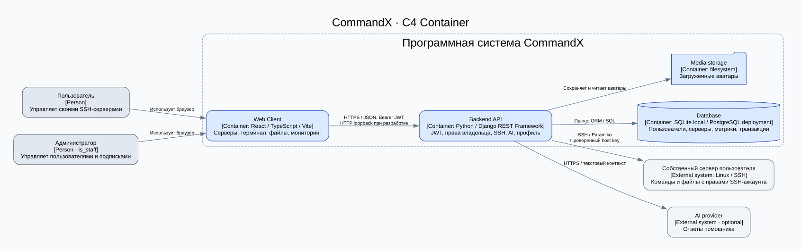

# CommandX

**Лабораторные по дисциплине «Разработка серверных приложений»**

[](https://github.com/bendyou/RSP/actions/workflows/checks.yml)


Панель управления собственными Linux-серверами по SSH: команды, файлы, мониторинг, профиль, подписки и опциональный AI-помощник. Все работы согласованы с существующим проектом CommandX на Django REST Framework и React/TypeScript.

[Архитектура](ARCHITECTURE.md) · [Контракт API](openapi.yaml) · [Результаты проверки](docs/REVIEW.md) · [Контекст проекта](docs/PROJECT_CONTEXT.md)

## Лабораторные

| № | Работа | Результат | Ветка для сдачи |
| --- | --- | --- | --- |
| 1 | [Архитектура и предметная область](lab1/README.md) | Роли, 11 Use Cases, C4 Container, ERD, словарь данных, PostgreSQL DDL | [lab1](https://github.com/bendyou/RSP/tree/lab1) |
| 2 | [REST API и OpenAPI](lab2/README.md) | 22 операции, 17 путей, 31 схема, локальный Swagger UI | [lab2](https://github.com/bendyou/RSP/tree/lab2) |
| 3 | [Каркас серверного приложения](lab3/README.md) | Django/DRF, слои, .env-конфигурация, health-check и 12 тестов | [lab3](https://github.com/bendyou/RSP/tree/lab3) |

Ветки последовательные: `lab2` включает №1, `lab3` — №1–№3. `main` содержит все завершённые работы. **Лабораторная №4 не выполнялась.** Для её будущего выполнения подготовлен [AGENTS.md](AGENTS.md).

## Быстрый запуск №3

Python 3.12–3.14. Из корня репозитория:

```sh
python3 -m venv .venv
.venv/bin/python -m pip install -r lab3/requirements.txt
test -f lab3/.env || cp lab3/.env.example lab3/.env
.venv/bin/python lab3/main.py
```

Проверка в другом терминале:

```sh
curl http://127.0.0.1:8000/api/health/
```

```json
{"status":"pass","app_name":"CommandX","version":"1.0.0","environment":"development","uptime_seconds":0}
```

Каркас содержит только health-check процесса. JWT, SSH, CRUD и работа с БД описаны в контракте и существующем исходном проекте; они не объявляются реализованными в №3.

## Просмотр API

```sh
python3 -m http.server 8082 --bind 127.0.0.1 --directory lab2
```

Откройте [Swagger UI](http://127.0.0.1:8082/swagger.html). Библиотеки включены локально, внешнего CDN нет. Отправка запросов отключена. [Инструкция и ответы на контрольные вопросы](lab2/ARCHITECTURE.md).

## Архитектура



Backend — Django REST Framework, аутентификация — SimpleJWT, удалённые операции — Paramiko. SQLite используется локально, PostgreSQL — при развёртывании. Модель включает User, UserProfile, Server, ServerMetric, Transaction и legacy AllocatedServer. [ER-диаграмма](lab1/diagrams/erd.svg) · [Полный отчёт](lab1/ARCHITECTURE.md).

## Проверки

```sh
.venv/bin/python -m pip install -r lab2/requirements-validation.txt
.venv/bin/python lab2/validate.py
.venv/bin/python lab3/manage.py check
.venv/bin/python lab3/manage.py test tests --settings=app.config.test_settings
.venv/bin/python tools/check_docs.py
```

CI проверяет контракт и каркас на Python 3.12, 3.13 и 3.14, а DDL — в пустой PostgreSQL 16. Локально выполнены проверка 66 полей/6 FK, 33 граничных случая контракта, 12 тестов каркаса и сверка 40 ответов исходного API. Подробности и команды — в [отчёте проверки](docs/REVIEW.md).

## Структура репозитория

```text
lab1/             архитектура, диаграммы и схема БД
lab2/             OpenAPI, Swagger UI и проверка контракта
lab3/             каркас Django REST Framework
docs/             контекст, контрольные суммы и результаты проверки
tools/            проверки схемы, ссылок и соответствия исходнику
AGENTS.md         правила для следующих лабораторных
ARCHITECTURE.md   полный отчёт №1 и таблица API №2
openapi.yaml      корневая копия контракта по требованию задания
```

В репозитории публикуются исходники и результаты лабораторных. Локальные `.env`, пользовательские данные, SSH-ключи, дампы, архивы и виртуальные окружения исключены из Git. `lab1/database/schema.sql` запускается только в отдельной пустой базе; развитие приложения выполняется миграциями Django.
